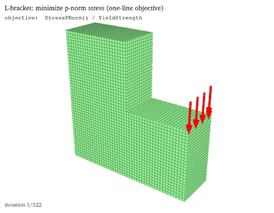
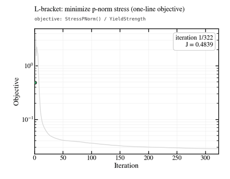
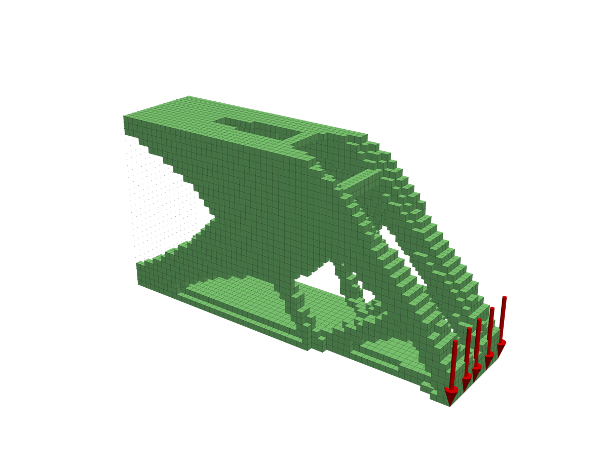
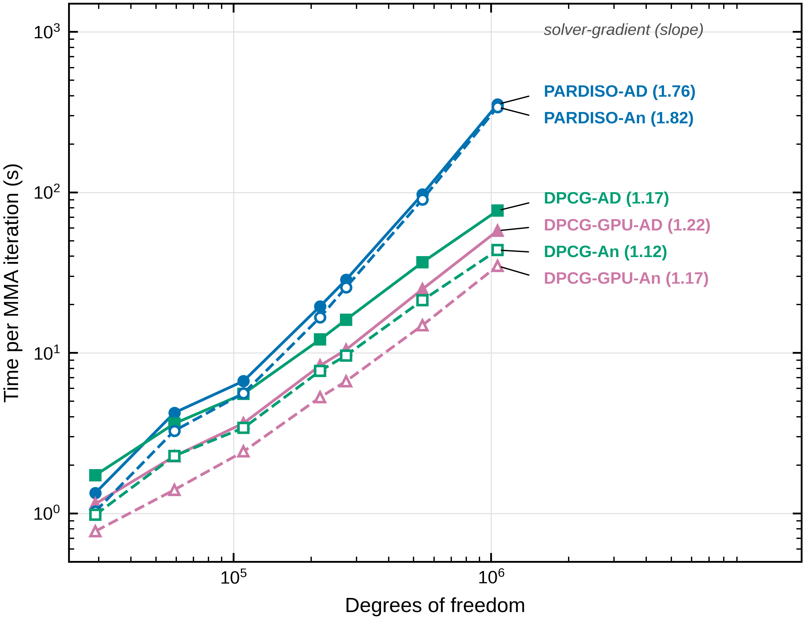

# PyTO: Python Topology Optimization

PyTO is a Python library, with a desktop GUI, for **3D topology optimization** of parts on voxel (hexahedral) meshes. You bring an STL of the design space, apply supports and loads, and PyTO finds where material should go to minimize, or maximize, an objective under constraints. Gradients come from **automatic differentiation** (PyTorch autograd through the FE solve), so new objectives and constraints need no hand-derived sensitivities.

<table>
  <tr>
    <td width="50%"></td>
    <td width="50%"></td>
  </tr>
  <tr>
    <td colspan="2"><b>Stress minimization from a one-line objective.</b> <code>StressPNorm() / YieldStrength</code> at 25 % volume on a 3D L-bracket (77,625 dofs, MMA, 322 iterations). The gradient comes from automatic differentiation; none is written by hand.</td>
  </tr>
  <tr>
    <td width="50%"></td>
    <td width="50%"></td>
  </tr>
  <tr>
    <td colspan="2"><b>3D designs and scaling to a million unknowns.</b> Left: edge-loaded cantilever, minimum compliance at 25 % volume (84,960 dofs, 132 iterations). Right: time per MMA iteration against problem size, up to about 10<sup>6</sup> dofs, for the direct (PARDISO) and GPU-capable iterative (DPCG) solvers, with automatic-differentiation (AD) and analytical (An) gradients; the fitted slopes are in brackets.</td>
  </tr>
</table>

**📖 Documentation: [docs/](docs/README.md)**: code and GUI guides, post-processing, extending PyTO, theory and reference.

## Capabilities
- **Physics:** linear elasticity, steady heat conduction, and one-way coupled thermo-structural analysis, on voxel meshes made automatically from STL files.
- **Method:** MMA (any objective and constraints), with automatic-differentiation or analytical gradients.
- **Formulations:**
  - compliance, volume, mass, displacement, temperature, reaction force, p-norm stress and failure factor;
  - **your own expressions** (e.g. `Displacement(Tip, y, mean) / 1e-3 + 0.1 * VolumeFraction()`) or **Python functions**, differentiated automatically;
  - optional **analytical gradients** for compliance, p-norm stress and volume fraction.
- **Manufacturing:** density filter, Heaviside projection, symmetry, cyclic symmetry, extrusion, keep-solid regions.
- **Results:** stress, deformation and temperature views, VTU export, and smooth STL recovery of the optimized part.
- **Validation:**
  - 46 benchmark problems;
  - thermo-structural problem set-ups taken from published work;
  - gradients checked against finite differences;
  - an automated test suite (`pytest`).

Tetrahedral FE is available for re-analysis of exported parts; optimization uses voxel meshes.
Not available yet: transient thermal, modal and large-deformation analysis.

## Installation
Python 3.10, in its own conda environment. Two ways, both described step by step in
[Installation](docs/getting-started/installation.md):

**A. Clone the repository**: the GUI, your own scripts, the tutorial problems, the examples, the tests and the
paper's studies ([details](docs/getting-started/installation.md#a-clone-the-repository)).
```bash
git clone https://github.com/UW-ERSL/PyTO-AD
cd PyTO-AD
conda create -n PyToLib python=3.10
conda activate PyToLib
pip install -r requirements.txt        # requirements-dev.txt adds the test tools
pip install -e .                       # optional: `import pyto` from anywhere, and the pyto-gui command
python run_gui.py                      # start the GUI
```

**B. Install with pip from GitHub**: the library and the GUI, for your own STL parts, without cloning
([details](docs/getting-started/installation.md#b-install-with-pip-from-github)).
```bash
conda create -n PyToLib python=3.10 && conda activate PyToLib
pip install --index-url https://download.pytorch.org/whl/cpu torch     # optional: CPU-only PyTorch, much smaller
pip install "pyto-ad @ git+https://github.com/UW-ERSL/PyTO-AD.git"
pyto-gui                                                                # start the GUI
```
The package is `pyto-ad`, imported as `pyto`. The tutorial problems, the quick-start scripts and the paper's
studies read their STL files from `Models/` in the repository, so they need a clone (A).

**Updating:** `git pull` in a clone; for a pip install,
`pip install --force-reinstall --no-deps "pyto-ad @ git+https://github.com/UW-ERSL/PyTO-AD.git"`
([details](docs/getting-started/installation.md#updating)). CPU-only PyTorch, macOS (no PARDISO; SciPy's solver is
used), newer `pyvista` versions and optional packages: [Installation](docs/getting-started/installation.md).

## Quick start: code
```python
from pyto.autodiff.sparse_solve import Solvers
from pyto.examples_benchmarks.topopt_structural_benchmarks import StructuralTOExamples, getStructuralTOProblem
from pyto.physics.structural.hex_structural_fea import HexStructuralFEA
from pyto.topopt.capabilities import check_gradient
from pyto.topopt.drivers.mma import topopt_mma
from pyto.topopt.spec import ConstraintSpec, ManufacturingSpec, ObjectiveSpec, OptimizationSpec, compile_spec

mesh, material, bc, body_force, to_params = getStructuralTOProblem(
    StructuralTOExamples.ThreeHoleBracketThick, nDOFDesired=20000)          # an STL part
fe = HexStructuralFEA(mesh=mesh, mat_prop=material, bc=bc, solver=Solvers.PARDISO, elem_body_force=body_force)
spec = OptimizationSpec(objective=ObjectiveSpec("Compliance()"),
                        constraints=[ConstraintSpec("VolumeFraction()", "<=", 0.25)],
                        manufacturing=ManufacturingSpec(symmetry=["Z"]))
to_params = compile_spec(spec, base=to_params)
print(check_gradient(to_params, fe))          # finite-difference check of the gradients, then optimize
u, history, success, message, n_fea = topopt_mma(fe, to_params=to_params, maxMMAIterations=to_params.MaxIterations)
```
Run with `PYTHONPATH=src`, or run the complete version: `python docs/examples/quickstart.py`. Next: [Quick start: code](docs/getting-started/quickstart-code.md), [A problem from scratch](docs/code/problem-from-scratch.md).

## Quick start: GUI
```bash
python run_gui.py
```
It restarts itself in the `PyToLib` environment if needed. Then work down the sidebar: Geometry → Material → Loads → Analysis → TopOpt Execute. See [Quick start: GUI](docs/getting-started/quickstart-gui.md).

To explore the benchmark problems, open `main.ipynb`: [Quick start: notebook](docs/getting-started/quickstart-notebook.md).

## Where to go next
| I want to ... | Read |
|---|---|
| set up my own problem in Python | [A problem from scratch](docs/code/problem-from-scratch.md) |
| optimize a custom quantity | [Expressions](docs/code/expressions.md), [User-defined functions](docs/code/user-defined-functions.md) |
| use the GUI | [GUI overview](docs/gui/overview.md) |
| plot and export results | [Post-processing](docs/postprocessing/history-and-convergence.md) |
| add physics, filters, methods or ML | [Extending PyTO](docs/extending/architecture.md) |
| run the benchmarks or the tests | [Benchmarks from code](docs/code/benchmarks-from-code.md), [Testing](docs/reference/testing.md) |
| reproduce the paper's results | [Reproducing the paper](docs/reference/reproducing-the-paper.md) |

## Repository layout
| Path | Contents |
|---|---|
| `src/pyto/` | the library ([architecture](docs/extending/architecture.md)) |
| `docs/` | documentation and runnable examples |
| `run_gui.py` | GUI launcher |
| `main.ipynb` | benchmark notebook |
| `Models/` | example STL files and projects |
| `tests/` | automated tests |
| `docs/paper/` | scripts for the paper's figures and analyses ([reproducing the paper](docs/reference/reproducing-the-paper.md)) |

## Contributing
Open an issue or a pull request. Please run the test suite before submitting ([Testing](docs/reference/testing.md)); new features come with tests ([Testing your extension](docs/extending/testing-your-extension.md)). By contributing, you agree that your contribution is licensed under GPL-3.0, like the rest of PyTO.

## License
Copyright (c) 2025-2026 UW-ERSL (Engineering Representations and Simulation Laboratory), University of Wisconsin-Madison.

PyTO is open-source software, licensed under the **[GNU General Public License v3.0](LICENSE)** (GPL-3.0):
- **You may** use, study, change and share PyTO for any purpose, including research, teaching and commercial work.
- **If you distribute** PyTO, or a program built on it, you must release its source code under GPL-3.0 as well, and keep the copyright and licence notices. Nobody can turn PyTO into closed-source software.
- **No warranty:** PyTO comes as is; see sections 15–16 of the licence.

The GUI uses PyQt5, which is itself GPL-3.0.

If you use PyTO in academic work, please cite the repository.
