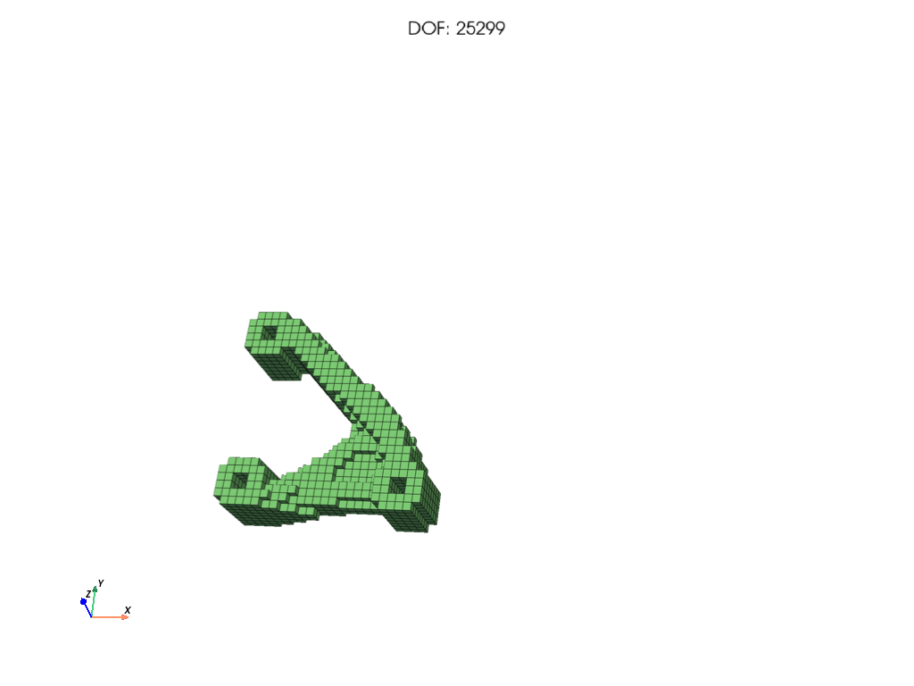

# Quick start: code

This page runs a complete topology optimization from Python in about 30 lines, and explains each step. It is for anyone who will use PyTO as a library.

The problem is a three-hole bracket, a real part given as an STL file: the two left holes are fixed and the right hole carries a load. PyTO-AD finds where to put 25 % of the material to make it as stiff as possible. It runs in about a minute with the PARDISO solver.

## The script
This is [`docs/examples/quickstart.py`](../examples/quickstart.py). Run it from the repository root with `python docs/examples/quickstart.py`.

```python
import os
import sys

sys.path.insert(0, os.path.join(os.path.dirname(os.path.abspath(__file__)), "..", "..", "src"))

import pyvista
pyvista.OFF_SCREEN = True                      # save images instead of opening windows

from pyto.autodiff.sparse_solve import Solvers
from pyto.examples_benchmarks.topopt_structural_benchmarks import StructuralTOExamples, getStructuralTOProblem
from pyto.physics.structural.hex_structural_fea import HexStructuralFEA
from pyto.topopt.capabilities import check_gradient
from pyto.topopt.drivers.mma import topopt_mma
from pyto.topopt.spec import ConstraintSpec, ManufacturingSpec, ObjectiveSpec, OptimizationSpec, compile_spec

# 1. Problem: the bracket STL, voxelized; two holes fixed, a load on the third
mesh, material, bc, body_force, to_params = getStructuralTOProblem(
    StructuralTOExamples.ThreeHoleBracketThick, nDOFDesired=20000)

# 2. Finite element analysis with the PARDISO direct solver (use Solvers.SPSOLVE where PARDISO is missing)
fe = HexStructuralFEA(mesh=mesh, mat_prop=material, bc=bc, solver=Solvers.PARDISO, elem_body_force=body_force)

# 3. Formulation: minimize compliance with at most 25 % of the material, symmetric about the mid-plane (z)
spec = OptimizationSpec(objective=ObjectiveSpec("Compliance()"),
                        constraints=[ConstraintSpec("VolumeFraction()", "<=", 0.25)],
                        manufacturing=ManufacturingSpec(symmetry=["Z"]))
to_params = compile_spec(spec, base=to_params)

# 4. Check the gradients, then optimize with MMA (gradients by automatic differentiation)
for r in check_gradient(to_params, fe):
    print(f"gradient check {r.name}: relative error {r.max_rel_error:.1e}")
u, history, success, message, n_fea = topopt_mma(fe, to_params=to_params,
                                                 maxMMAIterations=to_params.MaxIterations, print_progress=False)
print(f"compliance {history['objective'][-1]:.4g} J, volume {history['volfrac'][-1]:.3f}, {n_fea} FE solves")

# 5. Save a picture of the design
out = os.path.join(os.getcwd(), "quickstart_topology.png")
fe.plot_mesh(save_path=out, plot_bc=None, title=None)
print("saved", out)
```

Expected output (the numbers vary slightly between machines):
```
gradient check objective: relative error 1.0e-07
gradient check constraint 1: relative error 2.9e-09
compliance 0.3224 J, volume 0.250, 38 FE solves
```



## What each step does
1. **The problem.** `getStructuralTOProblem` builds one of PyTO-AD's tutorial problems. It returns:
   - the **mesh** (voxels made from an STL);
   - the **material** (steel);
   - the **boundary conditions** `bc`: fixed dofs and the load vector;
   - an optional **body force** (`None` here);
   - default optimization settings (`to_params`).

   `nDOFDesired` sets the mesh size, roughly the number of unknowns. How to build all of this yourself: [A problem from scratch](../code/problem-from-scratch.md).
2. **The FE solver.** `HexStructuralFEA` assembles and solves linear elasticity on the mesh, here with the PARDISO direct solver (use `Solvers.SPSOLVE` where PARDISO is not installed, e.g. on macOS). `fe.solve(x)` returns the displacements for a density `x`, and PyTorch can differentiate through that solve. See [Concepts](../code/concepts.md).
3. **The formulation.** An objective and constraints written as expressions (one-line text built from responses such as `Compliance()`) in an `OptimizationSpec`; `compile_spec` turns it into the settings the optimizer reads. Compliance is the work done by the load, uᵀKu; lower means stiffer. `compile_spec` takes every setting the spec covers from the spec, so the symmetry about the mid-plane is stated in it (`ManufacturingSpec(symmetry=["Z"])`); settings the spec does not cover (mesh size, material law) come from `base`. See [Formulations with specs](../code/formulation-with-spec.md) and [Expressions](../code/expressions.md).
4. **Check, then optimize.** `check_gradient` compares the gradient of the objective and of each constraint with central finite differences on 5 random elements (pass below 1e-3). It perturbs the optimizer's own design variables, so the check covers the whole chain the optimizer differentiates: density filter (with symmetry and extrusion), Heaviside projection if on, FE solve and response. `topopt_mma` then runs the Method of Moving Asymptotes (MMA) until its convergence test is met (at most `to_params.MaxIterations`, 150). It returns:
   - `u`: the displacement of the final design;
   - `history`: objective and volume fraction per iteration;
   - `success`, `message`: whether it finished cleanly;
   - `n_fea`: the number of FE solves.

   See [Running the optimizers](../code/running-optimizers.md).
5. **The result.** The final density is stored on the mesh (`mesh.elemPseudoDensity`). `plot_mesh` draws the solid elements. More options: [Fields and plots](../postprocessing/fields-and-plots.md).

## Try next
- Change `0.25` to `0.2` for a lighter design, or `StructuralTOExamples.ThreeHoleBracketThick` to `StructuralTOExamples.LBracketThickTopLoad`.
- Change one expression: [`docs/examples/quickstart_displacement.py`](../examples/quickstart_displacement.py) is this script minimizing the deflection of the loaded hole, `"Displacement(LoadHole, magnitude, pnorm)"` over a named node selection. PyTO-AD has no analytical gradient for it; automatic differentiation provides it. More expressions: [Expressions](../code/expressions.md).
- Write your own objective in Python: [User-defined functions](../code/user-defined-functions.md).

---
Next: [Concepts](../code/concepts.md) · [Back to contents](../README.md)
